# Backend — Diagram Source

> Hand this file to a diagram generator. Every section contains one Mermaid block that
> renders standalone. Prose exists only to explain what the diagram means.
>
> Sources of truth used to build this file:
> `docs/ARCHITECTURE.md`, `docs/PHASES.md`, `idea.md`,
> `my-agent/src/*.py`, `supabase/migrations/*.sql`,
> `supabase/functions/assistant-config/index.ts`, `ui/app/api/token/route.ts`,
> `ui/lib/actions/assistant.ts`.

---

## 0. Prompt to paste into the diagram generator

````
Read docs/BACKEND-DIAGRAMS.md. Render every ```mermaid block as a separate diagram.
Keep node labels exactly as written. Use the status colours from the legend:
green = implemented, amber = partial, grey dashed = planned only.
Produce the diagrams in the order they appear.
````

### Status legend

| Marker | Meaning |
|---|---|
| ✅ **implemented** | Code exists and runs today |
| 🟡 **partial** | Scaffolded, or implemented without its full contract |
| ⬜ **planned** | Described in the docs, no code yet |

---

## 1. What the backend actually is

Two planes, one runtime:

1. **Control plane (✅ implemented, Phase 1)** — Next.js 15 server routes/server actions in
   `ui/`, a Supabase Postgres database with RLS, and one Edge Function that is the agent's
   only door. It stores the assistant's configuration (prompt versions, model names, voice,
   greeting, flags) and serves it as a JSON *bundle* with an `ETag`.
2. **Runtime plane (✅ blackboard, 🟡 config-assisted)** — a Python 3.11/3.14
   `livekit-agents` worker in LiveKit Cloud. One process per job. It joins a LiveKit room,
   runs STT → LLM → TTS, and exposes eight **blackboard function tools** that broadcast
   structured drawing operations over LiveKit's data channel.

The blackboard is the only feature with a complete end-to-end backend today. The config
plane exists and is queryable, but the agent does **not** yet fetch the bundle
(`my-agent/src/config.py` does not exist), and `/api/token` is still the starter's
unauthenticated dev route.

> Rule that shapes everything: **the agent has no database credentials.** Configuration
> writes can never originate from the runtime plane.

---

## 2. System context

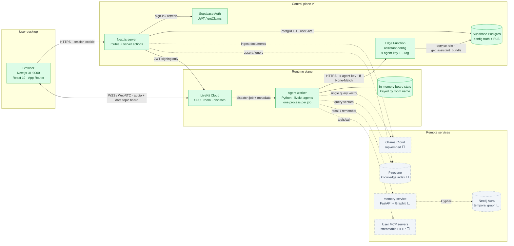

---

## 3. Backend code map

Where the behaviour in the rest of this document lives.

```mermaid
flowchart TB
    subgraph UI["ui/ — Next.js 15 server + client"]
        Token["app/api/token/route.ts<br/>signs participant JWT 🟡"]
        Middleware["middleware.ts<br/>session refresh"]
        Actions["lib/actions/assistant.ts<br/>server actions"]
        AuthLib["lib/auth.ts<br/>getSessionUser · getAssistantContext"]
        SbServer["lib/supabase/server.ts<br/>createServerClient"]
        SbClient["lib/supabase/client.ts<br/>createBrowserClient"]
        Pages["app/(app)/*<br/>assistant · prompts ✅<br/>tools · skills · knowledge<br/>memory · sessions · settings ⬜"]
        SessionUI["components/app/app.tsx<br/>useSession + TokenSource"]
    end

    subgraph DB["supabase/"]
        M1["migrations/0001_init.sql<br/>tables · triggers · RLS · RPCs"]
        M2["migrations/0002_bundle.sql<br/>get_assistant_bundle()"]
        Fn["functions/assistant-config/index.ts<br/>the agent's only door"]
    end

    subgraph AG["my-agent/ — Python worker"]
        Entry["src/agent.py<br/>rtc_session entrypoint"]
        Tools["src/board_tools.py<br/>8 function tools"]
        State["src/board_state.py<br/>seq · history · publish_data"]
        ConfigPy["src/config.py ⬜<br/>bundle fetch + snapshot"]
        EmbedPy["src/embed.py ⬜"]
        McpPy["src/tools_mcp.py ⬜"]
        KnowPy["src/tools_knowledge.py ⬜"]
        SkillPy["src/tools_skills.py ⬜"]
        MemPy["src/memory.py ⬜"]
        MemSvc["memory_service/ ⬜<br/>FastAPI + Graphiti"]
    end

    Pages --> Actions --> SbServer --> DB
    Pages --> AuthLib --> SbServer
    SessionUI --> Token
    Entry --> Tools --> State
    Entry -.-> ConfigPy
    Entry -.-> McpPy
    Entry -.-> KnowPy
    Entry -.-> SkillPy
    Entry -.-> MemPy
    Entry -.-> EmbedPy
    MemPy -.-> MemSvc
    ConfigPy -.-> Fn

    classDef done fill:#dcfce7,stroke:#16a34a,color:#14532d
    classDef partial fill:#fef3c7,stroke:#d97706,color:#78350f
    classDef plan fill:#f1f5f9,stroke:#94a3b8,color:#334155,stroke-dasharray:4 3
    class M1,M2,Fn,Entry,Tools,State,AuthLib,SbServer,SbClient,Actions,Middleware done
    class Token,SessionUI,Pages partial
    class ConfigPy,EmbedPy,McpPy,KnowPy,SkillPy,MemPy,MemSvc plan
```

---

## 4. Voice session + blackboard, end to end (✅ agent side · ⬜ canvas renderer)

The single most important flow: a student speaks, the model decides to draw, the drawing
lands on the student's canvas through the same LiveKit room.

> Accuracy note: everything left of the LiveKit publish is implemented. The **Board UI
> consumer** does not exist in `ui/` yet — no `RoomEvent.DataReceived` listener, no reducer,
> no canvas. The wire contract below is what a renderer must implement.

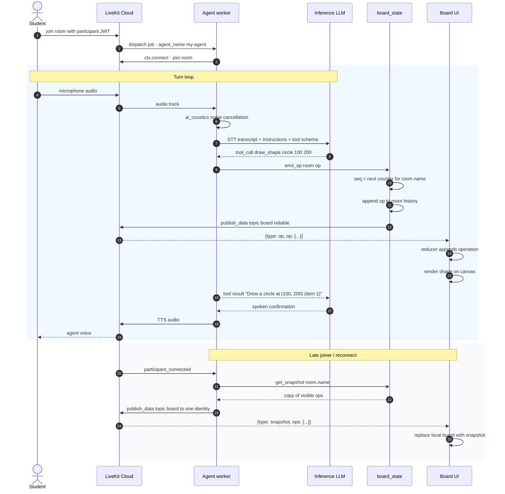

### Why it is shaped this way

- **The room is the session.** No second socket, no MCP server, no external store.
  `room.name` is the only key.
- **State lives in the worker process**, so it dies with the job. That is acceptable
  because a job *is* the conversation.
- **`reliable: true`** on every publish, so a dropped op cannot silently desync the canvas.
- **The snapshot is targeted** (`destination_identities`) — one participant, not a broadcast.
- **The clear op is broadcast but not persisted**, so a replayed snapshot can never
  resurrect a cleared board.

---

## 5. Blackboard message contract

Two message types, both JSON, both on topic `board`.

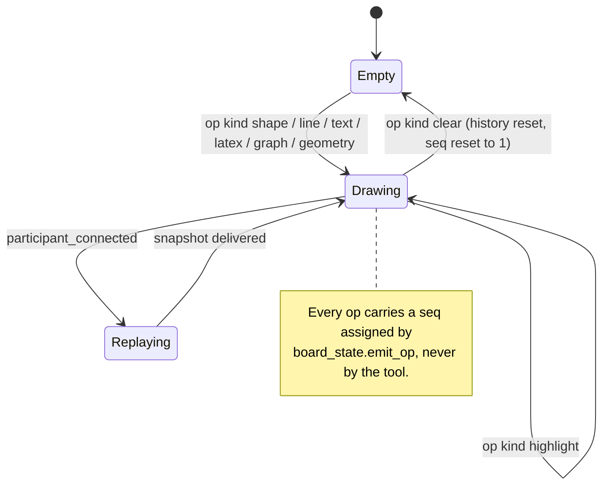

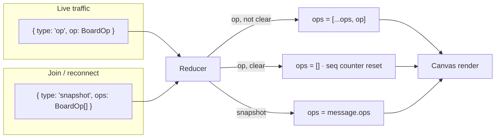

### Operation vocabulary (fixed, 8 kinds)

| `kind` | Emitted by | Payload fields |
|---|---|---|
| `shape` | `draw_shape` | `shape` circle/rect/triangle, `position` [x,y], `size`, `color` |
| `line` | `draw_line` | `from_` [x,y], `to` [x,y], `color` |
| `text` | `write_text` | `content`, `position` [x,y], `fontSize` |
| `latex` | `write_equation` | `content` (LaTeX), `position` [x,y] |
| `graph` | `plot_function` | `expr`, `domain` [x_min,x_max], optional `template` |
| `geometry` | `draw_labeled_geometry` | `pack`, `shape_id`, `position` [x,y], `size` |
| `highlight` | `highlight` | `targetSeq`, `color` |
| `clear` | `clear_board` | none — resets history and sequence counter |

Canvas coordinate space is roughly **0–800 x, 0–600 y**. Tool results are deliberately
short human sentences (e.g. `Drew a white circle at (100, 200) (item 1)`) so the LLM can
speak the outcome and later reference `item N` when calling `highlight`.

`geometry` packs: `geometry`, `algebra`, `statistics`, `physics`, `biology`, `chemistry`.
Unknown shape or pack raises `ToolError` inside the tool — the model sees a failure, the
session survives.

---

## 6. Session start — what runs today vs what the docs require

### 6.1 Today (🟡 partial)

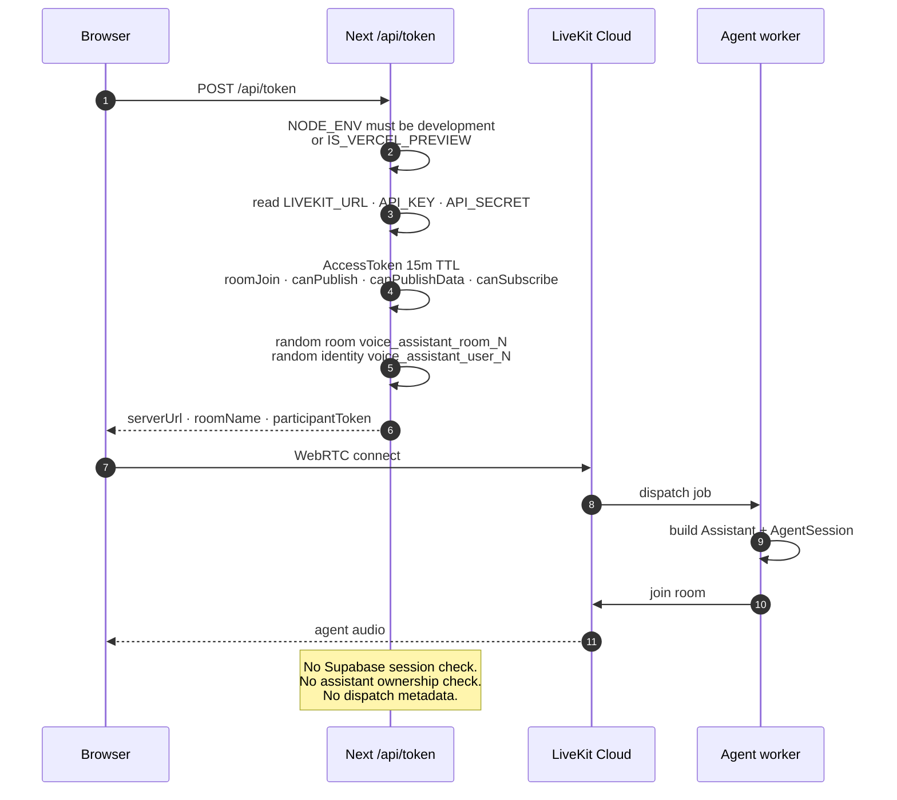

### 6.2 Target (⬜ per ARCHITECTURE §5)

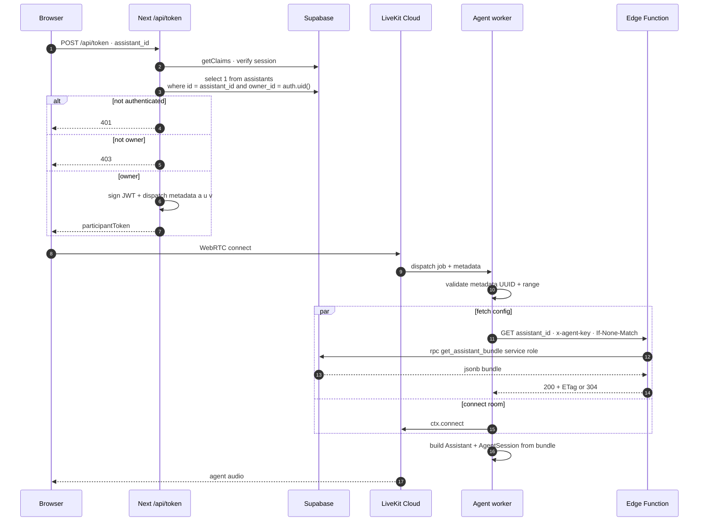

### 6.3 Config resolution fallback chain (⬜ agent side)

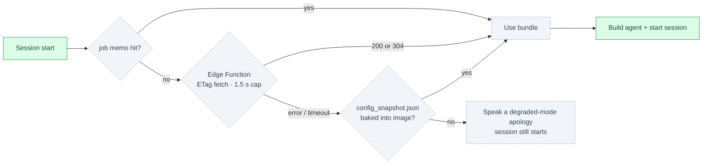

---

## 7. Config plane — read path (✅ Edge Function, ⬜ agent caller)

The agent never touches Postgres. It presents one shared key to one endpoint.

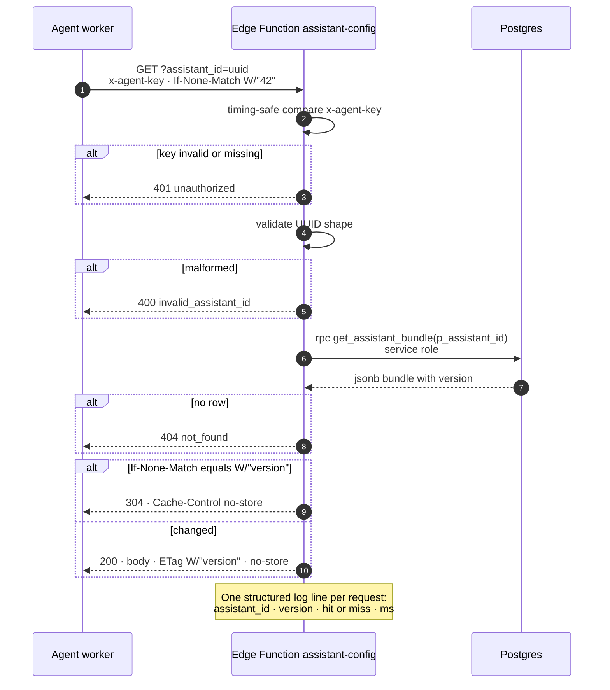

### Bundle contract returned by `get_assistant_bundle()`

```jsonc
{
  "version": 42,
  "assistant": { "id": "…", "name": "…" },
  "prompt": "You are a personal voice assistant…",
  "greeting": "Hey, I am ready when you are.",
  "llm": { "provider": "livekit-inference", "model": "google/gemma-4-31b-it", "temperature": 0.7 },
  "stt": { "model": "assemblyai/universal-3-5-pro", "language": "en" },
  "tts": { "model": "fishaudio/s2.1-pro", "voice": "fa4c9eb3…" },
  "expressive": true,
  "settings": {},
  "rag": { "enabled": false },
  "mcp": [],
  "skills": [],
  "memory": { "enabled": false }
}
```

`version` is the ETag source. `rag`, `mcp`, `skills`, `memory` are forward-compatible slots
read out of `assistant_config.settings`; they are empty until Phase 2–5.

---

## 8. Config plane — write path (✅ implemented)

Editing a prompt is the reference mutation. Note that **Activate and Rollback are the same
call**: point `active_version_id` at an existing version.

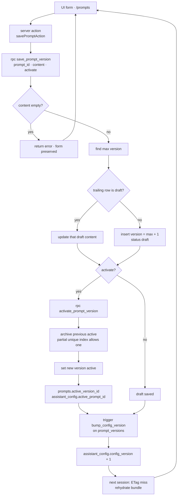

Three database guarantees behind it:

1. `prompt_versions` rows are **immutable in content once active** — rollback never rewrites text.
2. `prompt_versions_one_active_idx` is a partial unique index, so two active versions cannot exist.
3. `bump_config_version()` is attached to `prompts` and `prompt_versions`, so any change
   increments the single monotonic counter the agent compares.

Other server actions on the same pattern: `provisionAssistantAction` (first-run RPC that
creates assistant + config + prompt v1), `updateAssistantNameAction`,
`updateAssistantConfigAction` (model/voice/greeting; the row's own `BEFORE UPDATE` trigger
bumps the version).

---

## 9. Data model

### 9.1 Implemented tables (✅)

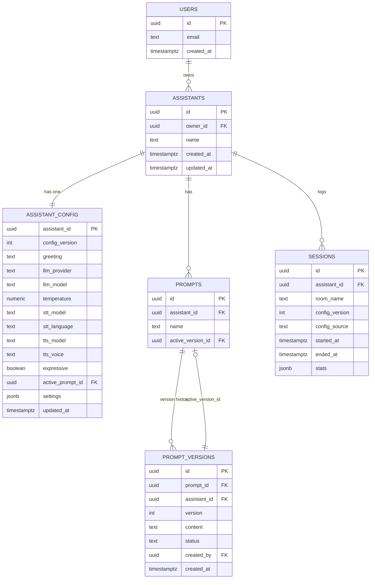

Notes that matter for a reader of the diagram:

- `SESSIONS.config_source` is constrained to `memo | etag | snapshot` — it records which
  hydration path a session actually used.
- `prompt_versions.status` is `draft | active | archived`.
- Every child table inherits ownership through `assistant_id`; `is_assistant_owner()` is the
  RLS predicate. There is no `owner_id` duplication except on `assistants`.

### 9.2 Planned tables (⬜ Phase 2–5)

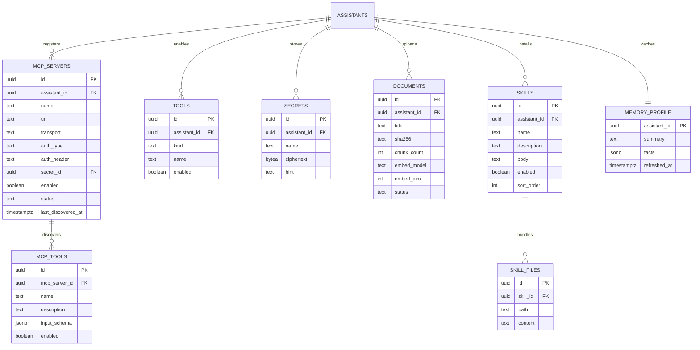

---

## 10. Ingest and memory pipelines (⬜ planned, Phase 3–4)

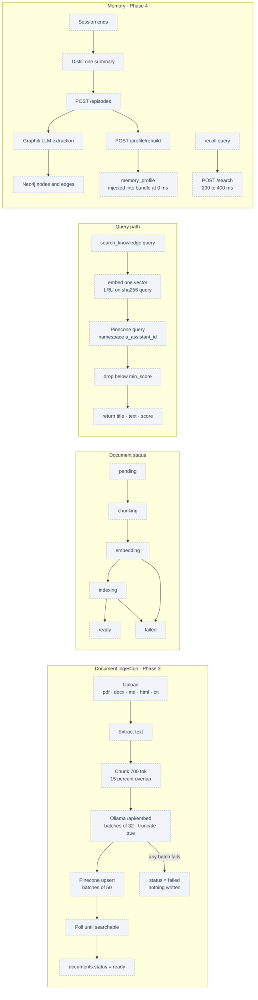

Two invariants worth drawing explicitly:

- **All-or-nothing embedding.** Every chunk of a document is embedded before any vector is
  written. A half-embedded document is invisible garbage that retrieves random chunks.
- **One embedding model, one width.** `EMBED_DIM` must equal the Pinecone index dimension.
  The agent probes `/api/embed` at boot and refuses to start on disagreement.

---

## 11. Deployment topology

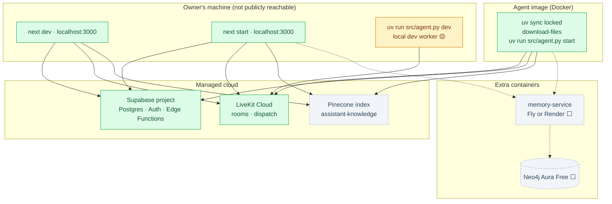

Hard constraint: **the agent must run somewhere publicly reachable** (LiveKit Cloud or a
container). A laptop worker cannot receive jobs for a cloud room. The UI never needs to be
reachable from the internet — it only makes outbound calls.

---

## 12. Phase roadmap

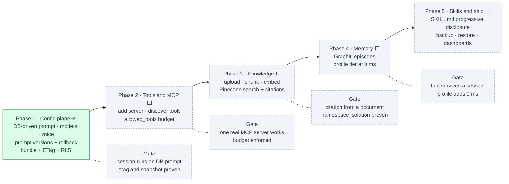

> Current reality check: Phase 1's **schema, triggers, RLS, RPCs, Edge Function and UI CRUD
> are done**; the **agent-side consumer** (`src/config.py`, bundle fetch, snapshot fallback)
> is not. The blackboard was built ahead of the phase plan and is fully working.

---

## 13. Failure and degradation map

Principle: **a degraded session always beats a failed session.** Every remote call on the
hot path has a timeout and a fallback.

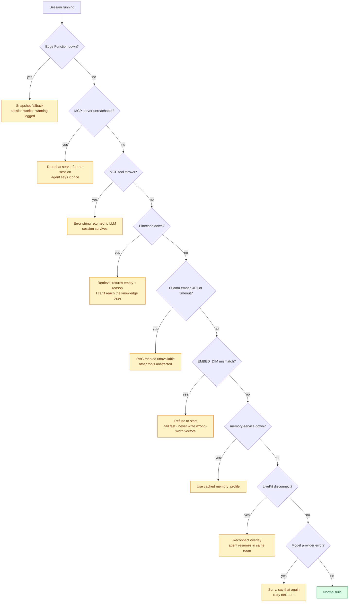

Blackboard-specific failures (implemented behaviour):

| Failure | Effect |
|---|---|
| Unknown `shape` value | `ToolError` raised; model told valid values; nothing published |
| Unknown `geometry` pack | `ToolError` raised; nothing published |
| `highlight` with an out-of-range seq | Op is still emitted; the renderer has no target and draws nothing |
| Participant joins before the agent | After `ctx.connect()`, the worker replays a snapshot to every participant already in the room |
| Clear board | History array reset **and** sequence counter reset to 1, so later snapshots contain only visible ops |

---

## 14. Security boundaries

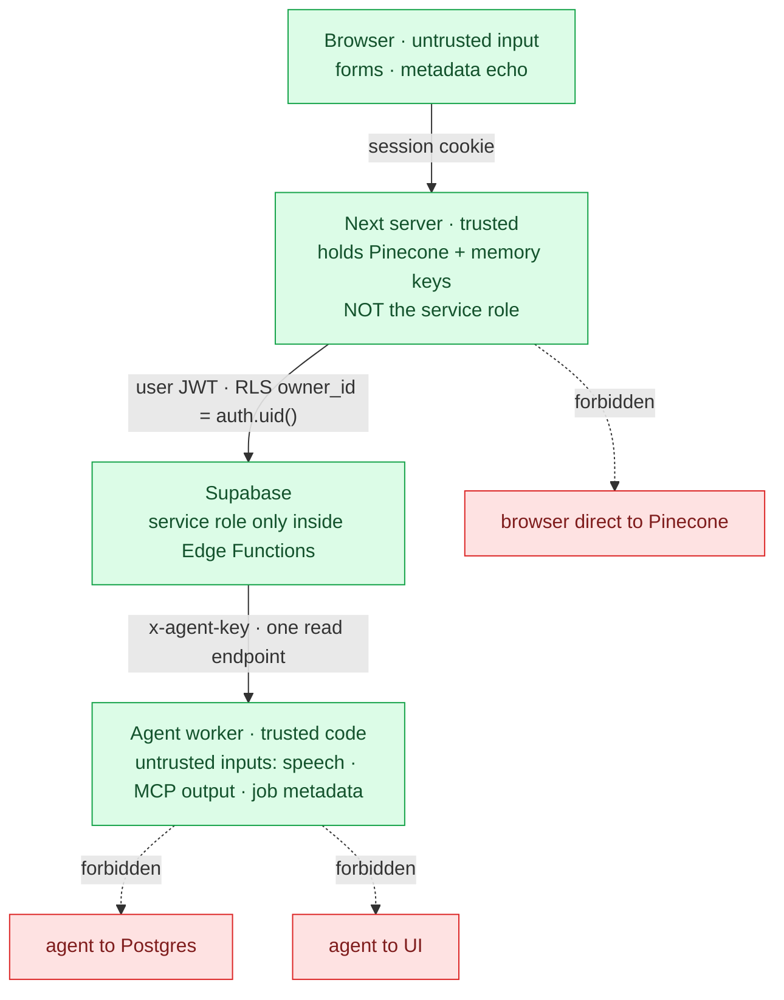

| Threat | Control |
|---|---|
| Anyone mints a token and burns LiveKit minutes | `/api/token` must require a session and verify assistant ownership (⬜ not yet wired) |
| Browser reads another assistant's config | RLS `owner_id = auth.uid()` on every table |
| MCP keys visible in DevTools | `pgp_sym_encrypt` at rest; only `hint` readable |
| Agent compromised gives full DB access | Agent has no DB credentials, only one read endpoint |
| Metadata spoofing | Validated shape + ownership re-check inside the bundle function |
| RAG cross-contamination | Pinecone namespace per assistant `a_<assistant_id>` |
| Memory cross-contamination | Graphiti `group_id` per assistant |
| Prompt injection via MCP output | MCP results framed as data, never instructions |

---

## 15. Environment surface

```mermaid
flowchart LR
    subgraph Shared["Shared by UI and agent — must agree"]
        E1["EMBED_PROVIDER"]
        E2["OLLAMA_BASE_URL"]
        E3["OLLAMA_API_KEY"]
        E4["EMBED_MODEL"]
        E5["EMBED_DIM"]
    end

    subgraph UIE["ui/.env.local"]
        U1["NEXT_PUBLIC_SUPABASE_URL"]
        U2["NEXT_PUBLIC_SUPABASE_PUBLISHABLE_KEY"]
        U3["LIVEKIT_URL · API_KEY · API_SECRET"]
        U4["AGENT_NAME"]
        U5["PINECONE_API_KEY · PINECONE_INDEX"]
        U6["MEMORY_SERVICE_URL · TOKEN"]
    end

    subgraph FnE["Edge Function secrets"]
        F1["AGENT_API_KEY"]
        F2["SECRET_ENCRYPTION_KEY"]
    end

    subgraph AgentE["my-agent/.env.local"]
        A1["AGENT_CONFIG_URL"]
        A2["AGENT_API_KEY"]
        A3["LIVEKIT_URL · API_KEY · API_SECRET"]
        A4["PINECONE_API_KEY"]
        A5["MEMORY_SERVICE_URL · TOKEN"]
    end

    Shared --> UIE
    Shared --> AgentE
    UIE -->|"x-agent-key shared"| FnE
    FnE -->|"same value"| AgentE

    classDef done fill:#dcfce7,stroke:#16a34a,color:#14532d
    classDef plan fill:#f1f5f9,stroke:#94a3b8,color:#334155,stroke-dasharray:4 3
    class E1,E2,E3,E4,E5,U1,U2,U3,U4,F1,A1,A2,A3 done
    class U5,U6,F2,A4,A5 plan
```

`EMBED_MODEL` / `EMBED_DIM` deliberately appear in two places. The guard: the agent
compares them against `rag.embed` in the bundle and aborts on disagreement, because a silent
dimension mismatch produces writes that succeed and retrieval that returns nonsense.

---

## 16. One-glance summary table

| Layer | Component | Implemented | Talks to |
|---|---|---|---|
| Presentation | Next.js UI, React 19 | ✅ assistant + prompts, ⬜ rest | Next server, LiveKit (WebRTC) |
| Control | Next server actions | ✅ | Supabase PostgREST |
| Control | Supabase tables + RLS + triggers | ✅ | — |
| Control | `get_assistant_bundle()` | ✅ | Edge Function |
| Control | Edge Function `assistant-config` | ✅ | Postgres (service role), agent |
| Runtime | Agent worker (`src/agent.py`) | ✅ | LiveKit, LLM/STT/TTS inference |
| Runtime | Blackboard tools + state | ✅ | LiveKit data channel |
| Runtime | Config hydration (`src/config.py`) | ⬜ | Edge Function, snapshot |
| Runtime | RAG (`search_knowledge`) | ⬜ | Ollama, Pinecone |
| Runtime | Memory (`recall` / session-end) | ⬜ | memory-service |
| Runtime | MCP toolset | ⬜ | MCP servers |
| Runtime | Skills progressive disclosure | ⬜ | Postgres via bundle |

---

*Generated from the repository on 2026-11-14. If a section disagrees with the code, the
code wins — update this file.*
